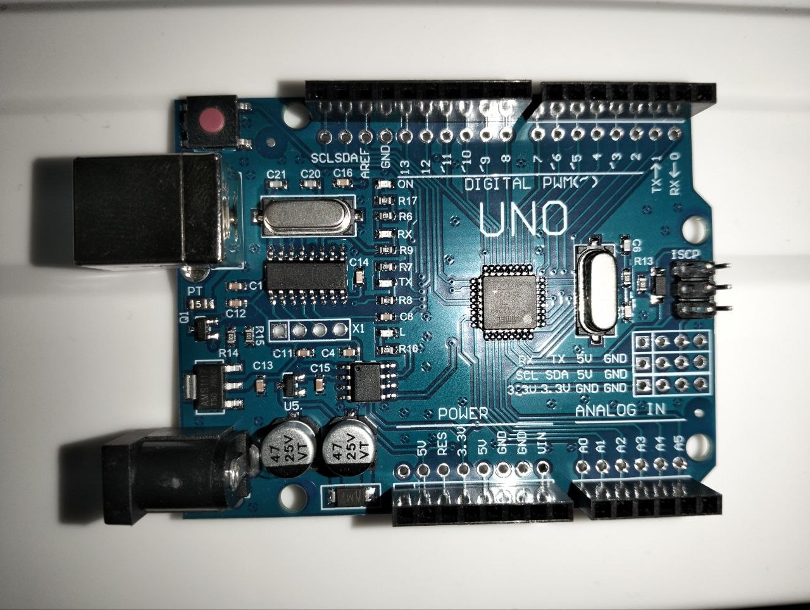
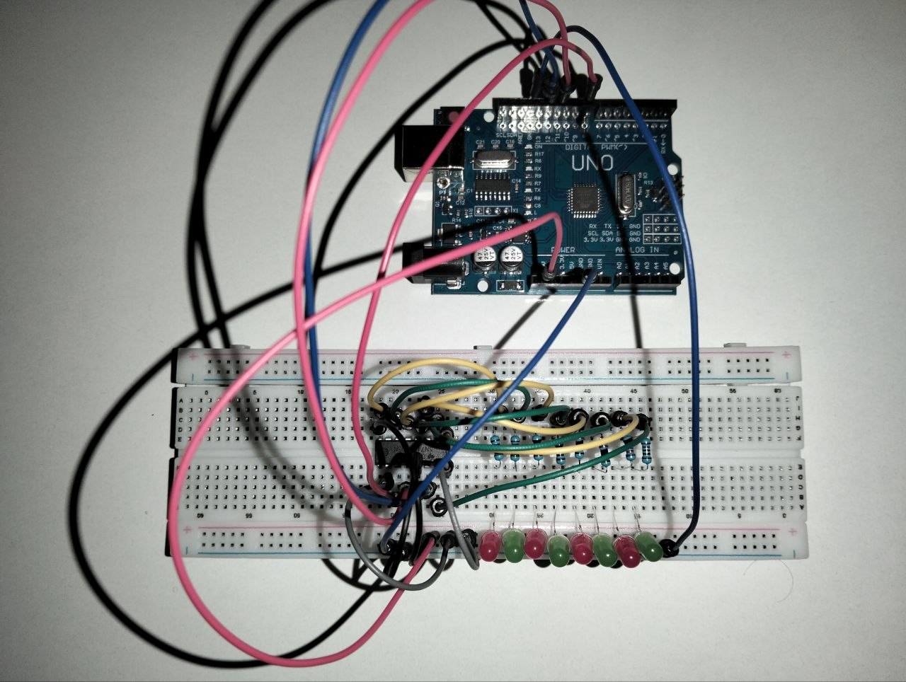

# ⚡ Control 8 LEDs with an 8-Bit Shift Register (SN74HC595N)

---

## 🧩 1. The Used Arduino Board and Components

### 🖥️ The Used Arduino Board

- Arduino UNO R3

> 

### 📦 The Used Components

- Arduino UNO R3 board
- `SN74HC595N` 8-bit shift register chip
- Breadboard
- 8x LEDs (any colors)
- 8x resistors (`220 Ω` or `330 Ω`)
- Jumper wires

> 

---

## 🎯 2. Project Goal

> The goal of this project is to control eight LEDs using only three Arduino pins (`Data`, `Clock`, and `Latch`) through the `SN74HC595N` shift register. Mastering serial-to-parallel shifting opens up many ideas, such as controlling anything <mark>not just LEDs</mark> like relays, buzzers, seven-segment displays, or larger output arrays without using up all digital pins.

---

## 🛠️ 3. How to Build the Circuit and Implement the Code

> Place the `SN74HC595N` across the center gap of the breadboard with Pin 1 aligned to your reference mark, then wire power and control lines cleanly: connect Pin 16 (`VCC`) and Pin 10 (`MR`) to `5V`, Pin 8 (`GND`) and Pin 13 (`OE`) to `GND`, Pin 14 (`DS`) to `dataPin`, Pin 11 (`SHCP`) to `clockPin`, and Pin 12 (`STCP`) to `latchPin`. Next, connect outputs `Q0`–`Q7` (Pins 15 and 1–7) to the anode (long leg) of each LED, and route each LED's cathode (short leg) through a `220 Ω` or `330 Ω` resistor to `GND`. Finally, open your sketch in the [Arduino IDE](https://www.arduino.cc/en/software/), set the three control pins as `OUTPUT`, send an 8-bit byte via `shiftOut()` (`MSBFIRST` or `LSBFIRST`) between `LOW` and `HIGH` pulses on `latchPin`, pick the matching COM port, and click **Upload**.

---

## 🎬 4. Final Circuit and Result Video

> 

🎥 **[Watch the Result Video](./final-result.mp4)**
