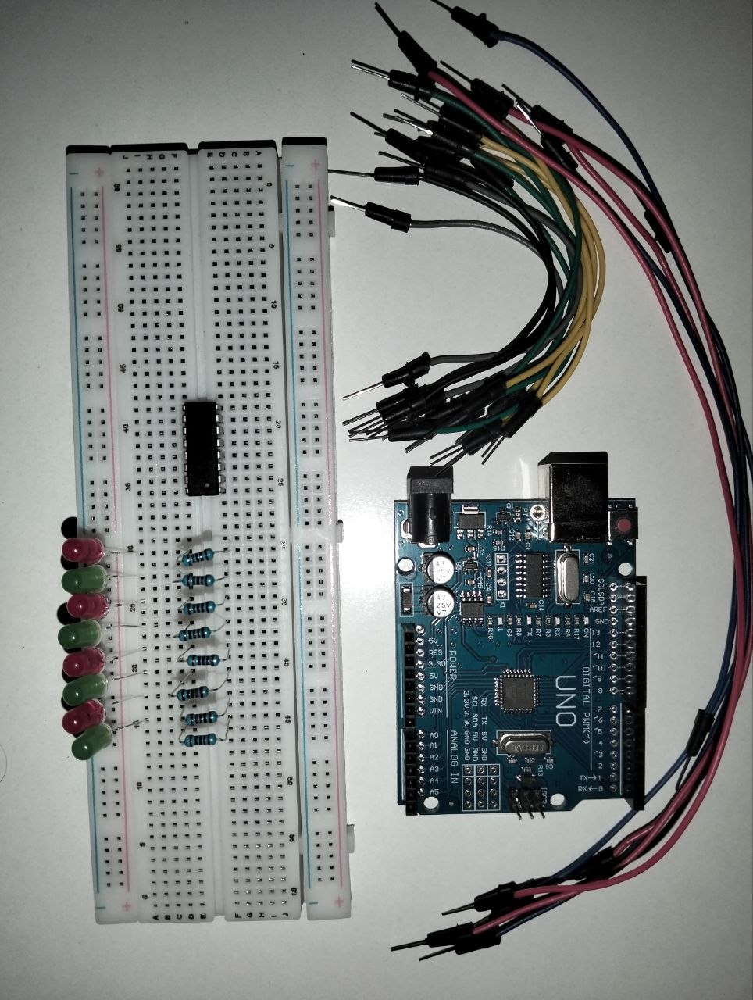

# ⚡ Control 8 LEDs with an 8-Bit Shift Register (SN74HC595N)

---

## 🧩 1. The Used Arduino Board and Components

### 🖥️ The Used Arduino Board

- Arduino UNO R3

> 

### 📦 The Used Components

- Arduino UNO R3 board
- `SN74HC595N` 8-bit shift register chip
- Breadboard
- 8x LEDs (any colors)
- 8x resistors (`220 Ω` or `330 Ω`)
- Jumper wires
- USB cable

> 

---

## 🎯 2. Project Goal

> The goal of this project is to control eight LEDs using only three Arduino pins (`Data`, `Clock`, and `Latch`) through the `SN74HC595N` shift register. The project demonstrates different LED patterns, including a normal shift, a circular shift, and a back-and-forth shift.

---

## 🛠️ 3. How to Build the Circuit and Implement the Code

### 🔌 A. Build the Circuit

Place the `SN74HC595N` across the center gap of the breadboard, making sure its notch or Pin 1 marker is oriented correctly. Connect the power and control pins as follows:

| SN74HC595N pin | Pin name | Connect to |
|---:|---|---|
| 16 | VCC | Arduino `5V` |
| 8 | GND | Arduino `GND` |
| 10 | MR / SRCLR | Arduino `5V` |
| 13 | OE | Arduino `GND` |
| 14 | DS / SER | Arduino data pin (`dataPin`) |
| 11 | SHCP / SRCLK | Arduino clock pin (`clockPin`) |
| 12 | STCP / RCLK | Arduino latch pin (`latchPin`) |

Connect the eight shift-register outputs to the LEDs. For each LED, connect the output to its anode (long leg), then connect its cathode (short leg) to `GND` through its own `220 Ω` or `330 Ω` resistor.

| LED | Shift-register output | Chip pin |
|---|---|---:|
| LED 0 | Q0 | 15 |
| LED 1 | Q1 | 1 |
| LED 2 | Q2 | 2 |
| LED 3 | Q3 | 3 |
| LED 4 | Q4 | 4 |
| LED 5 | Q5 | 5 |
| LED 6 | Q6 | 6 |
| LED 7 | Q7 | 7 |

> **Note:** Use one resistor for each LED. Do not connect LEDs directly to the shift-register outputs.

### 💻 B. Implement the Code

Open the required Arduino sketch in the [Arduino IDE](https://www.arduino.cc/en/software/). Make sure the `dataPin`, `clockPin`, and `latchPin` values in the code match your wiring. Set these pins as `OUTPUT`, select **Arduino UNO** under **Tools → Board**, choose the correct port under **Tools → Port**, then click **Upload**.

The examples below use `shiftOut()` to send an 8-bit pattern to the register. The latch pin updates the eight LED outputs after the bits have been sent.

### ➡️ C. Shift

In the shift pattern, one LED is turned on at a time and moves to the next position. When the bit moves from one position to another, the previous LED turns off. This creates a simple running-light effect across the eight LEDs.

### 🔄 D. Circular Shift

In the circular shift pattern, the lit LED moves through the eight positions and returns to the first LED after reaching the last one. The bit leaving one end is placed back at the other end, so the pattern repeats continuously without restarting from an empty state.

### ↔️ E. Back-and-Forth Shift

In the back-and-forth pattern, one lit LED moves from the first LED to the last LED, then reverses direction and travels back to the first. This creates a bouncing-light effect.

### 🧩 F. Other LED Patterns

You can also send different 8-bit values to display other patterns, such as turning all LEDs on or off, lighting alternate LEDs, or displaying a binary counting sequence. The pattern depends on the byte sent to the shift register and the selected bit order (`MSBFIRST` or `LSBFIRST`).

---
