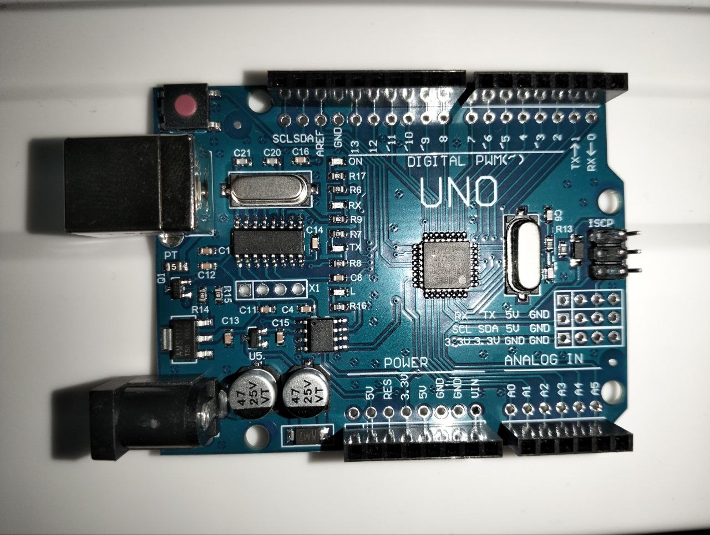
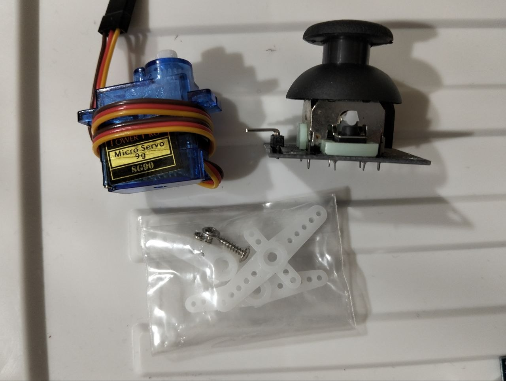

# Control Servo with a Joystick :

1. ## The used Arduino board and components :
   - #### The used Arduino Board :
     - Arduino UNO

     

   - The used Components :
     - Servo SG90 (180o)
     - Joystick

     

2. ## Project Goal :

   The <mark> main GOAL </mark> of this project is to understand the way of controling any types of <mark> Servos </mark> using the <mark> Joysticks </mark>, Because that open a lot of ideas, and the famous one is to combain two servos and control the First Servo wth the X value from the joystick and the Second Servo with the Y value from the joystick and this will look like an electrical arm that we can control it using a Joystick

3. ## How to implement this Project :
   1. <mark> First </mark> you need the Arduino Board and the Components like in the Pictures also a cables.

   2. <mark> Second </mark> you need to build the circuit you can Ask IA just to handle problems (also make sure that the code is depending on the pins that you chose)

   3. <mark> Thirdly </mark> implement the code or you can just download the sketch [ctrl-servo-joystick.ino](./ctrl-servo-joystick.ino) that i have in this project folder, place the skitch in the [Arduino IDE](https://www.arduino.cc/en/software/), adapte the USB that you use for the Arduino Board and press UPLOAD in the IDE and <mark> Congratulations </mark> try the Project and have fun with it.
